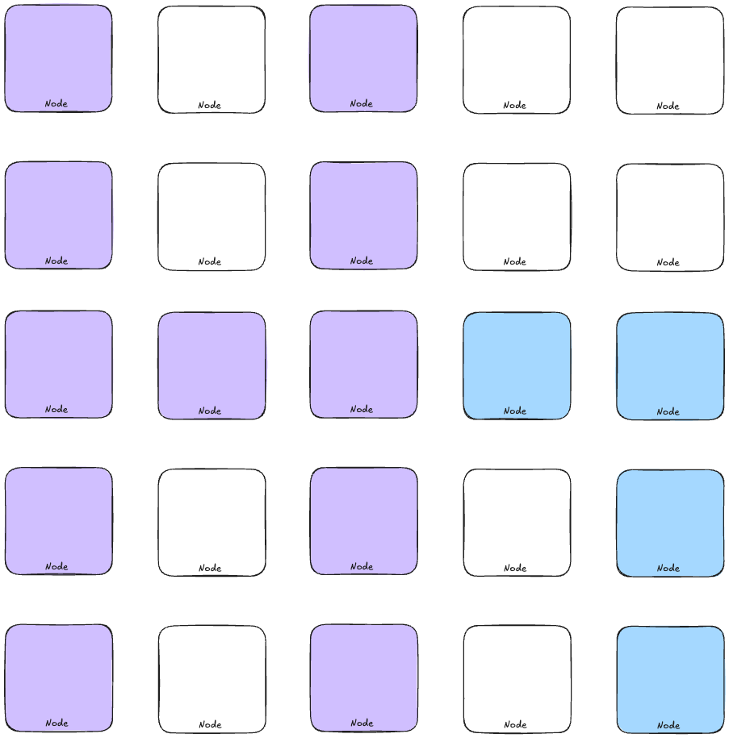

# hivemind


[](LICENSE)

hivemind runs containers on a few Linux machines, using Docker Engine on each one. You describe an app with flags or a YAML file. hivemind keeps the requested number of replicas running, and starts a replacement when a container exits or fails its health check.

This is version 2, a rewrite of version 1. Version 2.0.0 is not released yet. The current build runs on one machine. Joining more machines is not built yet.

hivemind is for 1 to 10 Linux machines on one network. It has one control-plane node, publishes container ports on host ports, and has no overlay network, no built-in DNS and no tenancy. Docker Swarm, Nomad and k3s do much more than that. hivemind is smaller to learn and run, and it is not a replacement for them.

## Install

The first v2 release is pending. When it is published, its assets are named as the release workflow names them:

```
hivemind-linux-amd64        node and client
hivemind-linux-arm64        node and client
hivemind-darwin-amd64       client only
hivemind-darwin-arm64       client only
hivemind-windows-amd64.exe  client only
hivemind-windows-arm64.exe  client only
SHA256SUMS
```

To build from source, use Go 1.26 or later:

```sh
git clone https://github.com/ao/hivemind.git
cd hivemind
CGO_ENABLED=0 go build -trimpath -o hivemind ./cmd/hivemind
```

The node (`hivemind serve`) needs Linux, amd64 or arm64, and Docker Engine 25 or newer. The other platforms can run the client against a server.

## Quick start

These commands run on one machine and use only loopback addresses. They assume `hivemind` is on your PATH and that you can reach the Docker socket. [docs/quick-start.md](docs/quick-start.md) explains each step and shows the output.

```sh
# Terminal 1. init creates the data directory and prints the admin token once.
hivemind init

# Terminal 1, and keep it running.
hivemind serve

# Terminal 2.
hivemind deploy --name web --image nginx:alpine --port 127.0.0.1:8080:80
hivemind status
curl -fsS http://127.0.0.1:8080/ > /dev/null
hivemind logs web

# worker publishes no port. Two replicas of an app with a host port would clash.
hivemind deploy --name worker --image nginx:alpine
hivemind scale worker 2
hivemind status worker
hivemind delete worker
hivemind delete web
```

`init` writes a client config, so the CLI on the same machine finds the server and the token without any environment variables.

## Limits

- One machine. `hivemind join` exits with an error. Node-to-node traffic, placement across machines and rescheduling after a machine is lost are not built.
- A change to an app's spec other than its replica count is a rolling update: one replica at a time. On one node every move is in place, so the replica being moved is down while its new container starts. A rollout that fails pauses and says why. See [concepts](docs/concepts.md#rolling-updates).
- Ports are published on host ports, and nothing checks for a clash when you deploy. When two apps publish the same host port, the second one can run without its port published, and `status` still reports it as running. See [concepts](docs/concepts.md#ports).
- `resources` are stored in the spec but not applied to containers.
- There is no web UI. The CLI and the HTTP API are the interfaces.
- Restart counts and health are in `/metrics`, not in `hivemind status`.

## Documentation

- [Quick start](docs/quick-start.md)
- [Concepts](docs/concepts.md)
- [CLI reference](docs/cli.md)
- [HTTP API](docs/api.md)
- [Upgrading from v1](docs/upgrading.md)
- [Roadmap](ROADMAP.md)
- [Assessment of v1](docs/ASSESSMENT.md) and [the v2 plan](docs/PLAN.md)

## Development

```sh
make test              # go test -race -count=1 ./...
make docs              # regenerate docs/cli.md
make quickstart-check  # run the quick start above against a node in Docker-in-Docker
```

## License

hivemind is licensed under the GNU General Public License v3.0. See [LICENSE](LICENSE).
